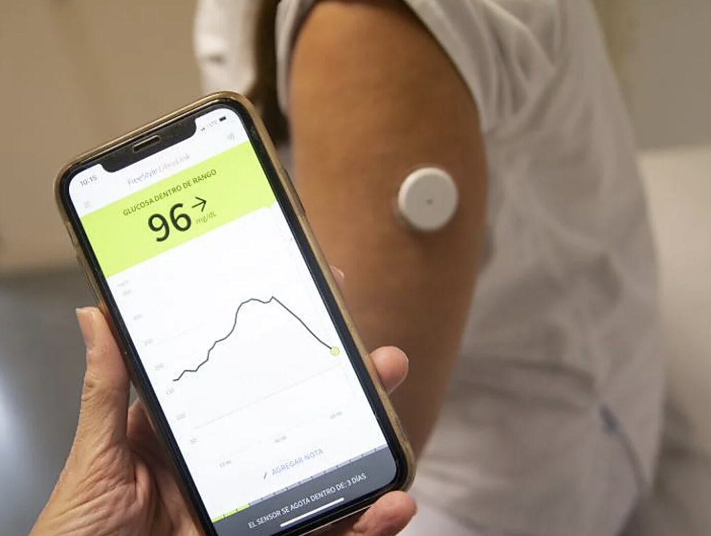
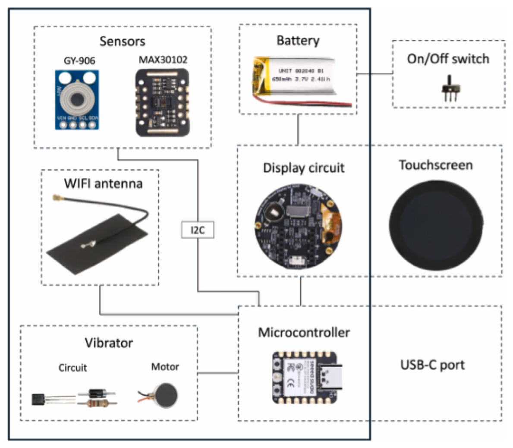

## {.center}

::: {style="text-align: center"}
{width="540px"}

[`altamarmx.github.io/WearablesIoTAgentesIA`](https://altamarmx.github.io/WearablesIoTAgentesIA/)
:::

::: {.notes}
30 s. Dejar la lámina el tiempo suficiente para escanear. El QR abre la
presentación publicada en GitHub Pages.
:::

## ¿Qué es un wearable?

- Dispositivo electrónico que se **porta en el cuerpo** y mide de forma continua
- Tres capacidades básicas: **sensar → procesar → comunicar**
- Del laboratorio al cuerpo: la medición deja de ser puntual y se vuelve personal y continua

<!-- TODO: línea de tiempo breve (podómetro → Fitbit → Apple Watch → anillos/parches) -->

::: {.notes}
1 min. Enfatizar la diferencia con un sensor fijo: el wearable sigue a la persona.
:::

## Ejemplo: sensor continuo de glucosa {.smaller}

::::: {style="font-size: 0.9em"}
:::: {.columns}
::: {.column width="28%"}


FreeStyle Libre (Abbott): parche en el brazo, lectura en el teléfono
:::
::: {.column width="36%"}
**Datos**

- Mide **líquido intersticial**, no sangre: filamento de 5 mm con glucosa oxidasa → corriente
- **1 lectura por minuto**, sin calibración
- MARD 9.2 % (Libre 2), 7.9 % (Libre 3)
- **NFC**: al acercar el teléfono baja 8 h de historial (1 dato / 15 min)
- **Bluetooth LE**: alarmas; Libre 3 transmite cada minuto
:::
::: {.column width="36%"}
**Energía**

- **Una pila de reloj** (óxido de plata SR626, 1.5 V) para sensor, MCU y radio: **14 días**
- No se recarga; el sensor se desecha
- La lectura NFC es pasiva: la alimenta el teléfono
- 35 mm × 5 mm, 5 g (Libre 2) → 21 mm × 2.9 mm, 1 g (Libre 3)
- IP27; opera de 10 a 45 °C
:::
::::
:::::

::: {.notes}
1–2 min. Es el patrón sensar → procesar → comunicar en un objeto de 5 g:
sensor electroquímico + MCU con NFC/BLE + pila de reloj = 14 días de datos
por minuto. Lleva además un termistor de piel para corregir la lectura.
La restricción de energía define el diseño; lo retomamos en la parte 3.
Fuentes: Abbott, ADA Consumer Guide, teardown de G. Lui (2022).
:::

## Tus datos no son tuyos {.smaller}

::::: {style="font-size: 0.92em"}
- **Lo que mide no es lo que te muestra**: PPG y acelerómetro a decenas de Hz; tú recibes
  "pasos", "sueño" y un *readiness score* sin fórmula publicada ni validación clínica
- **El negocio es la suscripción**: Oura ~6 USD/mes por ver tus propias métricas;
  Fitbit Premium ~10 USD/mes; Whoop solo vende suscripción (desde ~200 USD/año)
- **Las APIs entregan datos digeridos, no la señal**; sin señal cruda nadie puede auditar
  sesgos (tono de piel, tatuajes, movimiento)
- **Si la empresa cierra, el dispositivo muere**: Amazon Halo (2023) borró los datos;
  Pebble volvió porque Google liberó su código en 2025
- **En México son datos personales sensibles** (LFPDPPP): tienes derechos ARCO, pero el
  "acceso" es un CSV de métricas
- **Para investigar necesitamos** señal cruda, muestreo conocido, sensores que elegimos y
  firmware que controlamos: relojes abiertos (Bangle.js, PineTime)… o **construir el propio**
:::::

::: {.notes}
2.5 min. El punto: el hardware es el gancho; el producto es el servicio sobre tus
datos. Precios de 2026 (Fitbit 9.99 USD/mes, Oura 5.99 USD/mes, Whoop One
199 USD/año). Solo el ECG del Apple Watch pasó por la FDA (2018); "estrés" o
"body battery" no son medidas clínicas. Fitbit da datos por minuto solo a apps
personales y exige solicitud para el resto; Garmin reserva su API a empresas.
Halo: cierre anunciado en abril de 2023, app apagada el 1 de agosto, datos
borrados. PebbleOS liberado por Google el 27 de enero de 2025. Los estudios
sobre tono de piel y PPG no coinciden entre sí; el punto es que sin señal cruda
no se puede verificar. Aseguradoras y programas de bienestar laboral premian por
"compartir" datos; HIPAA no cubre estas apps. Otras salidas: Apple Salud exporta
XML, Garmin .FIT, Polar Verity Sense da señal cruda. Cierra con "construir el
propio" como puente al smartwatch del IER.
:::

## Caso IER: smartwatch para confort térmico {.smaller}

:::: {.columns}
::: {.column width="52%"}
- **Motivación**: los modelos adaptativos de confort necesitan encuestas **y**
  mediciones fisiológicas a la vez, y no había un wearable abierto que integrara ambas
- **Hardware abierto** (GPLv3), **~49 USD**, módulos comerciales, sin PCB a la medida
- XIAO **ESP32C3** (Wi-Fi + BLE) · **GY-906** (MLX90614): temperatura de piel por
  infrarrojo, ±0.5 °C · **MAX30102**: frecuencia cardiaca por PPG
- Pantalla táctil redonda de 240×240, motor vibrador, LiPo de 650 mAh (~8 h),
  carcasa impresa en 3D
:::
::: {.column width="48%"}
{width="100%"}
:::
::::

::: {.aside}
Landa, Barrios, Huelsz (2025). *HardwareX* 22, e00633. [doi:10.1016/j.ohx.2025.e00633](https://doi.org/10.1016/j.ohx.2025.e00633)
:::

::: {.notes}
1.5 min. Destacar: componentes comerciales de bajo costo, diseño reproducible,
archivos en Zenodo (doi:10.5281/zenodo.14835096). El diagrama es la figura de
componentes del artículo: sensores por I2C, pantalla, vibrador y antena Wi-Fi
alrededor del XIAO ESP32C3.
:::

## Internet de las Cosas en una lámina {.smaller}

```{mermaid}
flowchart LR
  A[Sensores<br/>wearables, ambiente] --> B[Microcontrolador<br/>ESP32]
  B --> C[Conectividad<br/>WiFi · BLE · MQTT]
  C --> D[Plataforma IoT<br/>ThingsBoard]
  D --> E[Visualización<br/>y actuación]
```

:::: {.columns}
::: {.column width="48%"}
- Objetos cotidianos con sensores, cómputo y red
- En el ambiente construido: temperatura, CO₂, ocupación, energía
- **El smartwatch ya recorre este camino completo**:
  XIAO ESP32C3 → WiFi → ThingsBoard (open source)
:::
::: {.column width="52%"}
**Lo que publica el smartwatch, en tiempo real**

- Encuesta de confort cada hora, con alerta vibratoria: ropa (*clo*),
  actividad (*met*), ubicación, sensación y aceptación térmica
- Fisiología: temperatura de piel en la muñeca y frecuencia cardiaca
- → base de datos robusta para **modelos adaptativos de confort térmico**
:::
::::

::: {.notes}
2 min. Flujo clásico: sensar → transmitir → almacenar → actuar. La interfaz de
encuestas está hecha con LVGL en la pantalla táctil; sensores calibrados contra
instrumentos de referencia (termómetro AET-R1B1, oxímetro Yonker YK-81C). El
smartwatch ya es, en sí mismo, un nodo IoT.
:::

## La IA no es un lugar: es una cadena {.smaller}

::::: {style="font-size: 0.85em"}
| Escalón | Energía | Ejemplo |
|---|---|---|
| **En el sensor** | µA | IMU ST LSM6DSOX: árbol de decisión integrado; clasificar actividad cuesta ~13 µA |
| **En el MCU** | mW | ESP32-S3: instrucciones vectoriales + ESP-DL / TFLite Micro (INT8) |
| **Con microNPU** | mJ → µJ | Arm Ethos-U55: MobileNetV2 de 624 a 8 ms y de 228 a 3 mJ; MAX78000: 251 µJ por palabra clave |
| **En el SoC del reloj** | — | Apple S9: Neural Engine, Siri procesada en el dispositivo |
| **En el gateway / laptop** | W | LLMs locales y agentes (nuestra demo) |

: {tbl-colwidths="[24,12,64]"}

**Cada eslabón hace lo mínimo necesario** y pasa al siguiente solo lo que importa.
:::::

::: {.notes}
2 min. Esta es la lámina conceptual clave para esta audiencia. Aclarar que las
cifras de Ethos-U55/MAX78000 son benchmarks de fabricante en modelos favorables;
la tendencia la confirman estudios independientes.
:::

## ¿Qué aporta un LLM al IoT? {.smaller}

- **Lenguaje natural como interfaz**: "¿cuál es la temperatura?, prende el ventilador"
- **Interpretación**: convertir series de datos en explicaciones y decisiones
- **Agentes**: el modelo no solo responde, **actúa** — invoca herramientas

Formas de integrarlo:

1. LLM en la **nube** (asistentes comerciales)
2. LLM **local** en una computadora junto al dispositivo ← *nuestra prueba de concepto*
3. Modelos pequeños **dentro del propio microcontrolador** (al final: 9 y 29 M de parámetros en un ESP32-S3)

::: {.notes}
1.5 min. Distinguir claramente: el LLM no corre en el ESP32; corre al lado,
y el ESP32 le presta sus "manos y sentidos".
:::

## Tool calling: las manos del modelo {.smaller}

- El modelo recibe una **lista de funciones** y decide cuándo llamarlas y con qué argumentos
- En `led.py` las herramientas son funciones de Python: el cliente de Ollama convierte
  el *docstring* y los *type hints* en el esquema que ve el modelo

```python
def color_led(r: int, g: int, b: int) -> str:
    """Enciende el LED con un color RGB.

    Args:
        r: rojo, 0-255
        g: verde, 0-255
        b: azul, 0-255
    """
    return board.send(f"RGB {r} {g} {b}")
```

- Usuario: *"pon una luz cálida"* → LLM llama `color_led(255, 140, 40)` →
  placa: `OK pin=48 on=1 rgb=255,140,40` → LLM: *"Puse el LED en un tono cálido"*

::: {.notes}
1.5 min. Concepto clave: el LLM decide, el microcontrolador ejecuta. Son cinco
herramientas: encender_led, apagar_led, color_led, parpadear_led y estado_led.
Agregar una = una función con docstring en led.py + un comando en el firmware.
El modelo traduce "cálido" a RGB por sí mismo; nadie programó esa tabla.
:::

## La prueba de concepto: `esp32LLM` {.smaller}

```{mermaid}
flowchart LR
  U[Usuario<br/>texto en español] --> P[led.py en la Mac<br/>5 herramientas]
  P <-- "chat + tools<br/>tool_call" --> O[Ollama<br/>LLM local]
  P <-- "USB serial<br/>comando → OK / ERR" --> F[ESP32-S3<br/>led_control.ino]
  F --> L[LED RGB<br/>GPIO 48]
```

- **Sin nube**: el modelo corre en la laptop con Ollama; la placa se conecta por USB
  o por Wi-Fi (`led-wifi.py`: la placa crea su propia red y escucha en TCP 2323)
- El firmware es un **protocolo de texto de seis comandos**:
  `ON`, `OFF`, `RGB r g b`, `BLINK n ms`, `PIN p`, `STATUS`; cada uno contesta `OK …` o `ERR …`
- La placa **no sabe nada de IA**: solo obedece

::: {.notes}
1 min. Explicar el recorrido antes de la demo. Placa ESP32-S3 N16R8 (16 MB de
flash, 8 MB de PSRAM); el LED es el WS2812 integrado en la DevKit. El protocolo
se puede probar sin modelo desde un monitor serial. La variante Wi-Fi conviene
en un auditorio: eduroam aísla equipos, la red propia esp32-led no.
:::

## Demo en vivo {background-color="#0f1226" data-background-gradient="radial-gradient(circle at 88% 10%, rgba(91,61,245,0.70) 0%, rgba(91,61,245,0) 42%), radial-gradient(circle at 6% 100%, rgba(201,242,107,0.28) 0%, rgba(201,242,107,0) 36%)"}

🔴 *"Está muy oscuro, pon una luz cálida y parpadea dos veces"*

```bash
uv run led-wifi.py       # la Mac en la red esp32-led, sin cable
```

::: {.notes}
2 min. Secuencia: (1) "¿cómo está el LED?" → estado_led; (2) "ponlo en morado"
→ color_led; (3) "parpadea tres veces y apágalo" → encadena dos herramientas.
Checklist: firmware led_wifi ya flasheado; la placa solo necesita alimentación
USB; la Mac conectada a la red esp32-led (clave esp32led); Ollama corriendo con
un modelo con tools. Plan B: video grabado de la demo.
:::

## ¿Qué tan pequeño puede ser un LLM? {.smaller}

::::: {style="font-size: 0.85em"}
- **Laptop**: modelos de 4–27B con *tools* conversan y actúan (nuestra demo)
- **Raspberry Pi 5**: TinyLlama 1.1B ≈ 14 tokens/s, suficiente para un agente simple
- **Dentro del ESP32-S3**, misma placa, otro firmware (`barista.py`, `stories.py`):

| | barista | tinystories |
|---|---:|---:|
| parámetros | 8.9 M | 28.9 M |
| en flash (int4) | 4.6 MB | 14.9 MB |
| hace | responde preguntas sobre espresso | escribe un cuento al arrancar |
| velocidad | ~14 piezas/s | ~5.5 tok/s |

- Caben porque el 81 % de los parámetros son tablas que se quedan en flash y se leen
  una fila por token (*Per-Layer Embeddings*, la idea de Gemma 3n); solo 1.6 M van a PSRAM
- Pero no siguen instrucciones ni llaman herramientas: el **agente útil vive en la laptop**;
  el microcontrolador presta **sensores y actuadores**
:::::

::: {.notes}
1 min. Modelos y runtime de slvDev/esp32-ai (MIT), incluidos como submódulo.
Barista: vocabulario de 854 piezas, no puede inventar números ni salirse del
tema. Stories: 5.5 tok/s medidos sin OLED (9.9 publicados). La placa guarda un
firmware a la vez; cambiar de programa tarda de 4 s a ~2 min según si hay que
reescribir el modelo.
:::

## Consideraciones y límites {.smaller}

- **Latencia**: un LLM local responde en segundos, no milisegundos
- **Confiabilidad**: puede elegir mal la herramienta o **narrar con confianza datos erróneos**
- **Seguridad**: dar *escritura* a un agente (accionar salidas) amplía la superficie
  de ataque — p. ej., inyección de prompts
- **Privacidad**: los datos fisiológicos son datos personales **sensibles**
- A favor: inferencia local = privacidad, sin costos de API, funciona sin internet

::: {.notes}
1 min. Honestidad técnica: es una prueba de concepto, no un producto. Mitigaciones:
permisos mínimos (API key de solo lectura), TLS en MQTT, validar qué tools se exponen.
:::

## La oportunidad para México {.smaller}

**Hay producción académica real:**

- Tec de Monterrey: biofeedback EEG en tiempo real para aprendizaje (random forest, 92.7%)
- CICESE: reconocimiento de marcha y wearables para personas con demencia
- UNAM: alerta temprana de COVID-19 con datos de smartwatch
- U. Panamericana: dataset UP-Fall de detección de caídas, muy reutilizado

**…pero concentrada en prototipos ESP32 + MQTT de signos vitales. Nichos abiertos:**

- TinyML en wearables **con validación** contra equipo de referencia
- Agentes LLM locales sobre plataformas IoT (ThingsBoard + MCP)
- Confort térmico personal en **climas mexicanos**
- → justo la intersección de esta plática

::: {.notes}
1.5 min. Verificar DOI/año de las citas mexicanas antes de dejarlas en la lámina.
Mensaje a estudiantes: estos nichos son tesis y artículos al alcance de una
universidad tecnológica.
:::

## Conclusiones

- Los **wearables** llevan la medición al cuerpo: continua y personal
- El **IoT** conecta esos datos con el ambiente construido
- Los **LLMs** agregan la pieza que faltaba: interpretar y actuar en lenguaje natural
- Todo esto es posible hoy con **hardware de bajo costo y modelos abiertos**

::: {.aside}
gbv@ier.unam.mx · altamarmx.github.io/WearablesIoTAgentesIA
:::

::: {.notes}
Preguntas. Posibles temas: qué modelo local se usó, tamaño del modelo,
hardware mínimo, cómo escalar a más dispositivos.
:::
